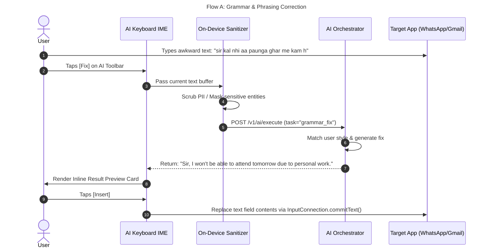

# Part 2: UX Design, Mobile Design System & Screen Specifications

---

## 1. Core UX Design Principles

```
  [ SPEED ]               [ CONTEXT ]             [ CONTROL ]            [ TRANSPARENCY ]
  1-Tap Execution          Smart Ingestion          User Directing         No Hidden Logging
  Target: < 1.5s           Zero Repetitive Prompts  Preview Before Insert  Clear Privacy Telemetry
```

1. **Micro-Interaction Speed**: The path from action to result must be sub-1.5 seconds. User flow: `Select Text / Type -> Tap Action -> Preview -> Tap Insert`.
2. **Context Efficiency**: Context is consumed automatically within permitted boundaries (e.g., current text input buffer, active selection) without forcing manual prompt engineering.
3. **Absolute User Control**: AI outputs are *never* auto-committed to input fields. The user must explicitly preview and tap `Insert`, `Replace`, or `Copy`.
4. **Privacy Transparency**: Clear visual indicators show when AI is processing text, what data is sent, and whether on-device or cloud models are utilized.

---

## 2. Design System Tokens (Light & Dark Modes)

AI Everywhere utilizes a clean, modern, native-inspired aesthetic with high contrast, crisp typography, and subtle indigo/violet AI accent cues.

```
+-----------------------------------------------------------------------------------+
|                            DESIGN SYSTEM COLOR TOKENS                             |
+----------------------+--------------------------+---------------------------------+
| Token Name           | Light Mode Value         | Dark Mode Value                 |
+----------------------+--------------------------+---------------------------------+
| `bg-primary`         | `#FFFFFF`                | `#0F172A` (Slate 900)           |
| `bg-secondary`       | `#F8FAFC` (Slate 50)     | `#1E293B` (Slate 800)           |
| `bg-tertiary`        | `#F1F5F9` (Slate 100)    | `#334155` (Slate 700)           |
| `keyboard-bg`        | `#ECEFF1` (Cool Grey)    | `#18181B` (Zinc 900)            |
| `key-cap-bg`         | `#FFFFFF`                | `#27272A` (Zinc 800)            |
| `key-cap-active`     | `#E2E8F0`                | `#3F3F46`                       |
| `text-primary`       | `#0F172A`                | `#F8FAFC`                       |
| `text-secondary`     | `#64748B`                | `#94A3B8`                       |
| `ai-accent-primary`  | `#6366F1` (Indigo 500)   | `#818CF8` (Indigo 400)          |
| `ai-accent-gradient` | `linear-gradient(135deg, #6366F1, #A855F7)`               |
| `success-green`      | `#10B981`                | `#34D399`                       |
| `warning-amber`      | `#F59E0B`                | `#FBBF24`                       |
| `error-red`          | `#EF4444`                | `#F87171`                       |
| `border-subtle`      | `#E2E8F0`                | `#334155`                       |
+----------------------+--------------------------+---------------------------------+
```

### Typography Scale
- **Display Header**: `Inter / SF Pro Display`, SemiBold, `28sp / 34dp line-height`
- **Section Title**: `Inter / SF Pro Text`, SemiBold, `20sp / 26dp`
- **Body Regular**: `Inter / SF Pro Text`, Regular, `15sp / 22dp`
- **Keyboard Key Label**: `Inter / SF Pro Text`, Medium, `18sp`
- **Toolbar Action Chip**: `Inter / SF Pro Text`, Medium, `13sp`
- **Caption / Meta**: `Inter / SF Pro Text`, Regular, `12sp`

---

## 3. Keyboard UI & AI Toolbar Architecture

The AI Keyboard replaces standard mobile keyboards while adding a compact, non-intrusive **AI Toolbar** directly above the candidate suggestion bar.

```
+-----------------------------------------------------------------------------------+
|                             AI KEYBOARD INTERFACE LAYOUT                          |
+-----------------------------------------------------------------------------------+
| [ AI TOOLBAR ]                                                                    |
|  [✨ AI]  [Fix]  [Rewrite]  [Reply]  [Translate]  [Tone ▾]  [More ⋯]              |
+-----------------------------------------------------------------------------------+
| [ WORD SUGGESTIONS / CORRECTION BAR ]                                            |
|  "I will"            "I'll send it"           "Tomorrow"                          |
+-----------------------------------------------------------------------------------+
| [ KEYBOARD KEY MATRIX ]                                                           |
|   Q   W   E   R   T   Y   U   I   O   P                                           |
|     A   S   D   F   G   H   J   K   L                                             |
|   ⇧   Z   X   C   V   B   N   M   ⌫                                            |
|   123   🌐   [✨ Write Like Me]   SPACE           .          ↵                    |
+-----------------------------------------------------------------------------------+
```

### Toolbar Action Specifications

| Chip | Vector Icon Name | Primary Action | Extended Menu (Tap ▾ / Hold) |
| :--- | :--- | :--- | :--- |
| **`AI`** | `<Icon name="sparkles" />` | Opens Master AI Action Bottom Sheet | Mode Switcher (Fast vs Quality) |
| **`Fix`** | `<Icon name="check-double" />` | Fixes grammar, typos & meaning instantly | Inline Diff Preview Toggle |
| **`Rewrite`** | `<Icon name="refresh-cw" />` | Rewrites text based on active style | Shorten, Expand, Professional |
| **`Reply`** | `<Icon name="message-square" />` | Generates 3 smart replies from context | Hinglish Reply, Casual, Formal |
| **`Translate`** | `<Icon name="languages" />` | Translates text to preferred target | Target Language Selector |
| **`Tone ▾`** | `<Icon name="sliders" />` | Opens Quick Tone Carousel | Professional, Casual, Friendly, Polite |
| **`More ⋯`** | `<Icon name="more-horizontal" />` | Checklist converter, Summary, Explain | Customize Toolbar Items |

---

## 4. Floating AI Assistant UI (Android & iOS Equivalent)

### Android Floating Bubble (`TYPE_APPLICATION_OVERLAY`)
- **Minimized State**: A translucent 44x44dp floating pill with a glowing gradient ✨ icon docked on the screen edge.
- **Repositioning**: Draggable along left/right screen edges with magnetic snap-to-edge animation.
- **Expanded State**: Tapping expands a compact 320dp action card displaying context-aware actions.
- **Dismiss Behavior**: Dragging bubble to bottom "X Close" zone hides overlay for current session.

```
+---------------------------------------------+
| Android Overlay Expanded UI                 |
+---------------------------------------------+
| ✨ AI Assistant                [ Privacy 🔒 ]|
| Selected Context: "Bro kal document bhej.."|
|                                             |
| Quick Actions:                              |
|  [ ⚡ Hinglish Reply ] [ 💼 Professional ] |
|  [ 📝 Summarize ]      [ 🌐 Translate ]    |
|                                             |
| [ Ask custom prompt...                  ➔ ] |
+---------------------------------------------+
```

### iOS Action Mechanism Equivalent
- Since iOS forbids draw-over-app floating windows, iOS provides two high-speed native entry points:
  1. **Keyboard AI Toolbar**: Primary entry point accessible in any text field.
  2. **iOS Action Extension (Share Sheet)**: Highlight text in any app (Safari, Notes, Mail) -> Tap `Share` -> Select `✨ AI Everywhere` -> View Action Sheet modal.

---

## 5. Screen Specifications (20 Key Screens)

```
       +---------------------------------------------------------------+
       |                       SCREEN MAP ARCHITECTURE                  |
       +---------------------------------------------------------------+
                                       |
           +---------------------------+---------------------------+
           |                                                       |
           v                                                       v
   [ ONBOARDING FLOW ]                                   [ MAIN APP DASHBOARD ]
   1. Splash Screen                                      4. Home Dashboard
   2. Welcome & Value Pitch                              5. Personal Writing Style Setup
   3. Permission Setup (IME/Overlay)                     6. Writing Style Editor
                                                         7. Usage & Metering Dashboard
                                                         8. Subscription & Paywall
                                                         9. Privacy & Security Center
                                                        10. Settings & Customization
                                                        11. Help & Support
                                                                   |
                                                                   v
                                                         [ KEYBOARD & INLINE UI ]
                                                         12. AI Keyboard Main View
                                                         13. Keyboard AI Toolbar
                                                         14. Inline Result Preview
                                                         15. Smart Reply Selector Sheet
                                                         16. Rewrite & Tone Modal
                                                         17. Translation Action Sheet
                                                         18. Explain & Summarize View
                                                         19. Context Confirmation Dialog
                                                         20. Offline & Error Alert Modal
```

### Wireframe Specifications & Behavioral Breakdown

#### Screen 1: Splash / Launch Screen
- **Visuals**: Slate dark background with animated SVG Sparkle (`✨`) pulsing in indigo-purple gradient.
- **Behavior**: Checks authentication session, downloads remote feature flag configs, pre-loads local language models, transitions to Home or Onboarding within `< 400ms`.

#### Screen 2: Onboarding - Permission Setup
- **Visuals**: Step-by-step progress cards.
- **Android Permissions**:
  - `Enable AI Keyboard` (System Settings Deep Link).
  - `Select AI Keyboard as Active Input` (System IME Picker).
  - `Draw Over Other Apps` (Optional for Floating Bubble).
- **iOS Permissions**:
  - `Enable AI Keyboard` (Settings -> Keyboards).
  - `Allow Full Access` (Required for API network calls to AI backend).
- **UX Guardrail**: Clear explanatory graphics explaining *why* permissions are needed (e.g., "Full Access is required strictly to fetch AI suggestions. Your typing is never saved.").

#### Screen 3: Home Dashboard
- **Visuals**: Clean card-based dashboard layout.
- **Top Card**: Active Writing Style Badge (e.g., "Style: Rohan's Casual Hinglish") with quick edit button.
- **Middle Cards**:
  - Daily Usage Meter (e.g., "18 / 25 Free AI Actions Used Today").
  - Quick Action Test Sandbox (Type & preview keyboard AI actions without changing apps).
- **Bottom Cards**: Recent AI Actions Log, Pro Upgrade Banner, Privacy Health Indicator (Green "Protected").

#### Screen 4: "Write Like Me" Personal Writing Style Setup
- **Visuals**: Interactive preference selector.
- **Form Controls**:
  - **Primary Languages**: Toggle chips (English, Hindi, Hinglish, Spanish, French).
  - **Formality Slider**: 5-point scale (Casual ➔ Neutral ➔ Professional).
  - **Verbosity Slider**: Concise / Balanced / Detailed.
  - **Emoji Density**: None / Sparse (1-2) / Heavy (3+).
  - **Writing Samples Box**: Optional text input to paste 3-5 real past messages.
- **CTA**: `Generate My Style Preview` button.

#### Screen 5: Inline Result Preview (Keyboard Overlay)
- **Visuals**: Compact card rendered directly above the keyboard layout.
- **Content**:
  - Original Text (Strikethrough / Red indicator).
  - AI Result Text (Highlighted in subtle green/indigo background).
  - Diff highlight showing changes.
- **Action Buttons**:
  - `Insert` (Green primary button - replaces text field contents).
  - `Copy` (Copies to clipboard).
  - `Regenerate ↻` (Re-runs action with secondary temperature).
  - `Tone ▾` (Quickly switch tone).

---

## 6. Detailed User Interaction Flows (Flows A through G)



### Flow B: Smart Reply in WhatsApp
1. User receives WhatsApp message: *"Bro kal tak wo document bhej dena."*
2. User opens keyboard in reply field. Taps `[Reply]` on AI Toolbar.
3. On-device context reader extracts active selection or clipboard context.
4. AI generates 3 quick reply chips:
   - Chip 1 (Casual): *"Sure bro, I'll send it by tomorrow."*
   - Chip 2 (Hinglish): *"Haan bro, kal pakka bhej dunga."*
   - Chip 3 (Professional): *"Yes, I will email the document to you by tomorrow EOD."*
5. User taps Chip 2.
6. Text is inserted into WhatsApp input field. User taps send manually.

### Flow C: Professional Email Morphing
1. User types rough draft in Gmail: *"hey john need the sales report asap client meeting tomorrow"*
2. User selects text and taps `[Tone ▾]` -> Selects `[Professional]`.
3. AI transforms text: *"Hi John, Could you please share the latest sales report at your earliest convenience? We have an upcoming client meeting tomorrow morning. Thanks!"*
4. User taps `[Insert]`.

---

## 7. Error, Offline & Edge Case UX Matrix

| Edge Case | Detection Trigger | UX Handling & Recovery Flow |
| :--- | :--- | :--- |
| **No Network Connection** | Device offline (`NetworkCapabilities.NET_CAPABILITY_INTERNET` missing) | Keyboard operates normally. AI Toolbar chips display subtle gray offline icon. Tapping action shows toast: *"Offline mode: Basic grammar available on-device."* |
| **AI Request Timeout** | Latency exceeds 3,500 ms | Cancel request automatically. Display preview card: *"Server taking longer than usual. [ Retry ↻ ]"* |
| **iOS Memory Spike (>25MB)** | `os_proc_available_memory()` check | Clear local prompt cache immediately. Gracefully purge UI image buffers to avoid 30MB OS crash limit. |
| **Sensitive Input Field** | IME flag `TYPE_TEXT_VARIATION_PASSWORD` / `NUMBER_PASSWORD` detected | AI Toolbar automatically disables itself and shows lock icon: *"AI paused for password field."* |
| **Usage Limit Exceeded** | HTTP 429 (`limit_exceeded`) from API | Show clean bottom sheet: *"You've used all 25 free daily AI actions. Upgrade to Pro for unlimited actions. [ Upgrade to Pro ]"* |

---

*Continue to [**Part 3: Native Mobile Architecture (Android & iOS)**](./03-MOBILE-ARCHITECTURE-ANDROID-IOS.md) for deep IPC, memory, and IME execution details.*
