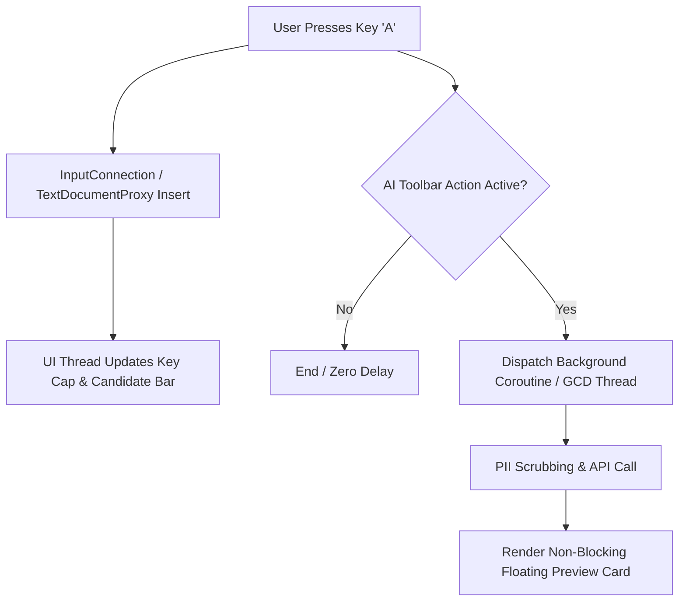

# Part 3: Native Mobile Architecture (Android & iOS)

---

## 1. Architectural Strategy & Modular Framework

To guarantee sub-100ms keyboard startup latency, strict memory bounds, and native OS compliance, **AI Everywhere** employs a **Hybrid Platform Architecture**:

```
+-----------------------------------------------------------------------------------+
|                            MOBILE CLIENT MODULE ARCHITECTURE                      |
+-----------------------------------------------------------------------------------+
| [ NATIVE OS ADAPTER LAYER ]                                                       |
|                                                                                   |
|   +------------------------------------+    +----------------------------------+  |
|   |         ANDROID IME MODULE         |    |        iOS EXTENSION MODULE      |  |
|   |  - InputMethodService (Kotlin)     |    |  - UIInputViewController (Swift)  |  |
|   |  - Floating Overlay (WindowManager)|    |  - Share Extension (SwiftUI)     |  |
|   +-----------------+------------------+    +----------------+-----------------+  |
|                     |                                        |                    |
|                     +-------------------+--------------------+                    |
|                                         |                                         |
|                                         v                                         |
| [ SHARED CORE CORE ENGINE (Kotlin Multiplatform / C++ / Rust Core) ]               |
|  - Tokenizer & Privacy Regex Sanitizer Engine                                     |
|  - Asynchronous Key Event Pipeline (Zero-Latency Guarantee)                       |
|  - Local Storage Reader (App Group / Encrypted SharedPrefs)                       |
|  - Network Client (HTTP/2, gRPC, SSE Streaming)                                   |
|  - Offline Model Cache Manager                                                    |
+-----------------------------------------------------------------------------------+
```

---

## 2. Android Systems Deep-Dive

### IME Lifecycle (`InputMethodService`)
The core keyboard runs inside Android's `InputMethodService`. The service lifecycle must strictly manage window creation, view inflating, and input connections.

```kotlin
// Android IME Service Implementation Blueprint
package com.aieverywhere.keyboard.service

import android.inputmethodservice.InputMethodService
import android.view.View
import android.view.inputmethod.EditorInfo
import com.aieverywhere.core.privacy.SanitizerEngine
import com.aieverywhere.core.network.AiOrchestrationClient
import kotlinx.coroutines.*

class AiKeyboardService : InputMethodService() {
    private val serviceScope = CoroutineScope(Dispatchers.Main + SupervisorJob())
    private lateinit var keyboardView: View
    private lateinit var aiToolbarView: View

    override fun onCreateInputView(): View {
        keyboardView = layoutInflater.inflate(R.layout.keyboard_main_layout, null)
        aiToolbarView = keyboardView.findViewById(R.id.ai_toolbar_container)
        setupKeyListeners()
        setupAiToolbarActions()
        return keyboardView
    }

    override fun onStartInputView(info: EditorInfo?, restarting: Boolean) {
        super.onStartInputView(info, restarting)
        // Detect sensitive fields (Password, OTP, Credit Cards)
        val isPassword = (info?.inputType?.and(EditorInfo.TYPE_MASK_CLASS)) == EditorInfo.TYPE_CLASS_TEXT &&
                (info.inputType and EditorInfo.TYPE_TEXT_VARIATION_PASSWORD != 0 ||
                 info.inputType and EditorInfo.TYPE_TEXT_VARIATION_WEB_PASSWORD != 0)

        if (isPassword) {
            aiToolbarView.visibility = View.GONE // PAUSE AI ON SENSITIVE FIELDS
        } else {
            aiToolbarView.visibility = View.VISIBLE
        }
    }

    fun executeAiAction(actionType: String) {
        val inputConnection = currentInputConnection ?: return
        val selectedText = inputConnection.getSelectedText(0)?.toString()
        val contextText = if (!selectedText.isNull_or_Empty()) {
            selectedText
        } else {
            inputConnection.getTextBeforeCursor(500, 0)?.toString() ?: ""
        }

        serviceScope.launch(Dispatchers.IO) {
            val sanitizedInput = SanitizerEngine.scrubPii(contextText)
            val result = AiOrchestrationClient.requestAction(actionType, sanitizedInput)
            
            withContext(Dispatchers.Main) {
                renderInlinePreviewCard(result) { acceptedText ->
                    if (!selectedText.isNull_or_Empty()) {
                        inputConnection.commitText(acceptedText, 1)
                    } else {
                        // Replace previous buffer
                        inputConnection.deleteSurroundingText(contextText.length, 0)
                        inputConnection.commitText(acceptedText, 1)
                    }
                }
            }
        }
    }

    override fun onDestroy() {
        super.onDestroy()
        serviceScope.cancel()
    }
}
```

### Foreground Floating Bubble (`TYPE_APPLICATION_OVERLAY`)
For Android floating assistant overlays, `WindowManager` manages a lightweight custom view:

```kotlin
val params = WindowManager.LayoutParams(
    WindowManager.LayoutParams.WRAP_CONTENT,
    WindowManager.LayoutParams.WRAP_CONTENT,
    WindowManager.LayoutParams.TYPE_APPLICATION_OVERLAY,
    WindowManager.LayoutParams.FLAG_NOT_FOCUSABLE,
    PixelFormat.TRANSLUCENT
).apply {
    gravity = Gravity.TOP or Gravity.START
    x = 0
    y = 100
}
windowManager.addView(floatingBubbleView, params)
```

---

## 3. iOS Systems Deep-Dive (`UIInputViewController`)

### Memory Architecture & The 30MB Hard Limit
iOS imposes a strict 30MB RAM ceiling on keyboard app extensions. Exceeding this limit causes an immediate crash (`EXC_RESOURCE`).

```
+-----------------------------------------------------------------------------------+
|                        iOS KEYBOARD MEMORY ALLOCATION BUDGET (30MB)              |
+-----------------------------------------------------------------------------------+
| [ System UI Frameworks & UIKit ]                    ~ 10.5 MB                     |
| [ Key Layout Engine & Touch Receiver ]              ~  4.2 MB                     |
| [ AI Toolbar UI & State Machine ]                   ~  3.1 MB                     |
| [ Network Client & Shared Data Buffer ]             ~  3.8 MB                     |
| [ Dynamic Heap Reserve & Safety Margin ]            ~  8.4 MB                     |
|                                                                                   |
| TOTAL ALLOCATION TARGET:                             < 22.0 MB (Safe Margin)      |
+-----------------------------------------------------------------------------------+
```

### Swift Keyboard Extension Implementation Blueprint

```swift
// iOS Keyboard Extension Controller Blueprint
import UIKit

class KeyboardViewController: UIInputViewController {
    @IBOutlet var nextKeyboardButton: UIButton!
    private var aiToolbarView: UIView!
    private var isFullAccessEnabled: Bool {
        return isOpenAccessGranted()
    }

    override func viewDidLoad() {
        super.viewDidLoad()
        setupKeyboardLayout()
        setupAiToolbar()
    }

    private func setupAiToolbar() {
        guard isFullAccessEnabled else {
            renderFullAccessRequiredBanner()
            return
        }
        // Initialize lightweight custom toolbar view (No heavy SwiftUI image caching)
        aiToolbarView = AiToolbarView(delegate: self)
        self.view.addSubview(aiToolbarView)
    }

    func handleAiActionTriggered(action: String) {
        guard let proxy = textDocumentProxy as? UITextDocumentProxy else { return }
        
        let selectedText = proxy.selectedText ?? ""
        let precedingText = proxy.documentContextBeforeInput ?? ""
        let inputPayload = selectedText.isEmpty ? precedingText : selectedText

        // Execute background request via shared session
        AiNetworkManager.shared.performAction(action: action, payload: inputPayload) { [weak self] result in
            DispatchQueue.main.async {
                self?.presentInlinePreview(result: result) { acceptedText in
                    if !selectedText.isEmpty {
                        proxy.insertText(acceptedText)
                    } else {
                        // Delete previous characters and insert replacement
                        for _ in 0..<precedingText.count {
                            proxy.deleteBackward()
                        }
                        proxy.insertText(acceptedText)
                    }
                }
            }
        }
    }
}
```

### IPC Data Flow (App Extension ↔ Main Host App)
On iOS, the main app and keyboard extension run in separate processes. Data sharing occurs via **App Groups**:

```
[ Main iOS App ] -- (Writes Preferences) --> [ App Group Shared Container ]
                                                    |
                                          (NSUserDefaults / Keychain)
                                                    |
                                                    v
[ Keyboard Extension ] <-- (Reads Config) <-- [ App Group Container ]
```

- **App Group Identifier**: `group.com.aieverywhere.app`
- **Darwin Notifications**: `CFNotificationCenterGetDarwinNotifyCenter()` triggers instant UI reloads when writing style preferences update in the main app.

---

## 4. Zero-Latency Typing Engine Architecture

The typing engine uses an **Asynchronous Uncoupled Event Architecture**. Typing keystrokes are processed instantly on the UI main looper thread without awaiting AI network operations.



### Core Performance Benchmarks
- **Keystroke Render Latency**: `< 8 ms` (60fps / 120fps display fluid target).
- **Cold Launch Latency**: Android `< 75 ms`, iOS `< 60 ms`.
- **Memory Footprint**: Android `< 42MB`, iOS `< 23MB`.

---

*Continue to [**Part 4: Cloud Backend & AI Orchestration Architecture**](./04-BACKEND-AND-AI-ORCHESTRATION.md) for API schemas, multi-model routing, and prompt engineering.*
