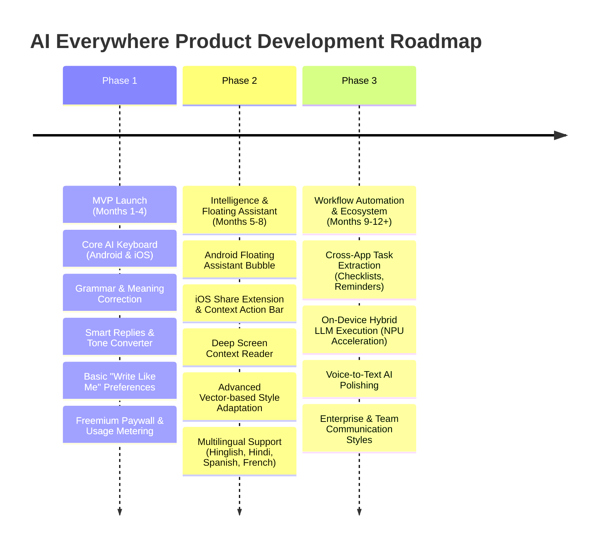

# AI Everywhere --- Product & Technical Architecture Specification

> **"An AI assistant that helps you write, understand, and respond --- anywhere on your phone."**

Welcome to the production-grade, implementation-ready product, UX, and technical architectural specification for **AI Everywhere**.

---

## 📌 Executive Summary

**AI Everywhere** is a cross-platform (Android & iOS) mobile communication and productivity layer designed to seamlessly integrate AI intelligence into every application on a user's phone. Unlike traditional standalone chatbot apps or basic AI keyboards, AI Everywhere functions as an ambient, context-aware assistant embedded directly within the user's mobile workflow.

### Core Value Proposition
- **Less App Switching**: Access state-of-the-art AI directly within WhatsApp, Gmail, Slack, Twitter/X, Instagram, Chrome, and iMessage.
- **Instant Productivity**: 1-Tap Grammar Correction, Tone Transformation, Contextual Reply Generation, Text Summarization, and Translation.
- **Personalized Voice ("Write Like Me")**: AI engine fine-tuned to mirror the user's specific vocabulary, emoji density, formality, and linguistic nuances (e.g., Hinglish, casual English, concise professional tone).
- **Privacy by Design**: On-device PII redaction, zero server-side message history retention, and explicit user-driven context-sharing controls.

---

## 🗂 Specification Document Directory

This repository contains the complete 5-part engineering & product design specification:

| Document | Description | Key Topics |
| :--- | :--- | :--- |
| [**`01-PRODUCT-VISION-AND-STRATEGY.md`**](./01-PRODUCT-VISION-AND-STRATEGY.md) | Vision, Strategy & Platform Policy | Target Personas, JTBD, Value Proposition, Android vs. iOS System Capability Matrix, Store Policy Guidelines, Competitive Positioning |
| [**`02-UX-AND-DESIGN-SYSTEM.md`**](./02-UX-AND-DESIGN-SYSTEM.md) | UX Design & Mobile Design System | Design System Tokens, Keyboard UI & Toolbar, Floating Assistant, 20+ Screen Wireframes, User Flows A-G, Edge Cases |
| [**`03-MOBILE-ARCHITECTURE-ANDROID-IOS.md`**](./03-MOBILE-ARCHITECTURE-ANDROID-IOS.md) | Native Mobile Systems Architecture | Android `InputMethodService` vs. iOS `UIInputViewController`, App Groups, 30MB Memory Budget, IPC, Zero-Latency Typing Engine |
| [**`04-BACKEND-AND-AI-ORCHESTRATION.md`**](./04-BACKEND-AND-AI-ORCHESTRATION.md) | Cloud Backend & AI Engine | Multi-Model Routing, Context Sanitizer, "Write Like Me" Vector Personalization, PostgreSQL/Redis Schema, REST/gRPC API Specifications |
| [**`05-PRIVACY-SECURITY-MONETIZATION.md`**](./05-PRIVACY-SECURITY-MONETIZATION.md) | Privacy, Security & Unit Economics | On-Device PII Scrubbing, StoreKit 2 / Google Play Billing, SaaS Unit Economics (₹149-₹299/mo), Compliance & Metrics |

---

## 📐 System Master Architecture Blueprint

```
+-----------------------------------------------------------------------------------+
|                                 MOBILE CLIENT LAYER                               |
|                                                                                   |
|  +----------------------------------+        +---------------------------------+  |
|  |       ANDROID ENVIRONMENT        |        |         iOS ENVIRONMENT         |  |
|  |  - InputMethodService (IME)      |        |  - UIInputViewController        |  |
|  |  - Foreground Floating Bubble    |        |  - App Extension (30MB Limit)   |  |
|  |  - Accessibility Service (Opt)   |        |  - Share Sheet / Action Ext    |  |
|  +-----------------+----------------+        +----------------+----------------+  |
|                    |                                          |                   |
|                    +--------------------+---------------------+                   |
|                                         |                                         |
|                                         v                                         |
|                        Local On-Device Privacy Sanitizer                          |
|                        - PII Masking & Regex Scrubbing                            |
|                        - Sensitive Input Filter (Passwords, Cards)                |
+-----------------------------------------+-----------------------------------------+
                                          |
                                          | HTTPS / TLS 1.3 (gRPC / REST)
                                          v
+-----------------------------------------------------------------------------------+
|                                BACKEND CLOUD LAYER                                |
|                                                                                   |
|                           [ API Gateway / Envoy Router ]                          |
|                                         |                                         |
|           +-----------------------------+-----------------------------+           |
|           |                             |                             |           |
|           v                             v                             v           |
|   [ Auth & Rate Limit ]       [ Profile & Style Svc ]       [ Usage Metering ]    |
|           |                             |                             |           |
|           +-----------------------------+-----------------------------+           |
|                                         |                                         |
|                                         v                                         |
|                           [ AI Orchestration Engine ]                             |
|                           - Task Type Detection                                   |
|                           - Prompt Template Builder                               |
|                           - Vector Personalization Injector                       |
|                                         |                                         |
|                                         v                                         |
|                             [ Dynamic Model Router ]                              |
|                    +--------------------+--------------------+                    |
|                    |                    |                    |                    |
|                    v                    v                    v                    |
|             Fast Latency LLM     Balanced Model       Reasoning / Long LLM        |
|             (Grammar, Fix)       (Rewrite, Style)     (Summary, Explain)          |
+-----------------------------------------------------------------------------------+
```

---

## 🗓 3-Phase Product Execution Roadmap



---

## 🎯 Target Performance & SLA Targets

- **Keyboard Cold Start Latency**: `< 80 ms`
- **Typing Engine Response Time**: `0 ms delay` (Zero blocking on UI thread)
- **Fast AI Action SLA (Grammar / Tone)**: `< 600 ms` end-to-end
- **Complex AI Action SLA (Summarize / Reply)**: `< 1,200 ms` end-to-end (Streamed)
- **Memory Footprint**: Android IME `< 45MB`, iOS Extension `< 26MB` (Strictly under 30MB OS limit)
- **Crash-Free Sessions Target**: `> 99.8%`

---

## 🔐 Core Engineering Principles

1. **Never Block Typing**: AI processing must run strictly asynchronously on background threads. The primary keyboard layout and keystrokes must function flawlessly even during network outages.
2. **Explicit Consent Context**: No background screen scraping or continuous keylogging. Context is evaluated only when explicitly triggered by the user or within permitted OS boundaries.
3. **Multi-Model Routing Flexibility**: Architecture decoupled from any single AI vendor (OpenAI, Anthropic, Gemini, Local models) using standard abstraction interfaces.
4. **Privacy as a Feature**: Transparent privacy dashboard showing exact processing telemetry, zero message storage policies, and one-click data purge.

---

*Refer to the individual specification files listed above for detailed component architectures, code interfaces, wireframe specifications, database schemas, and unit economics.*
